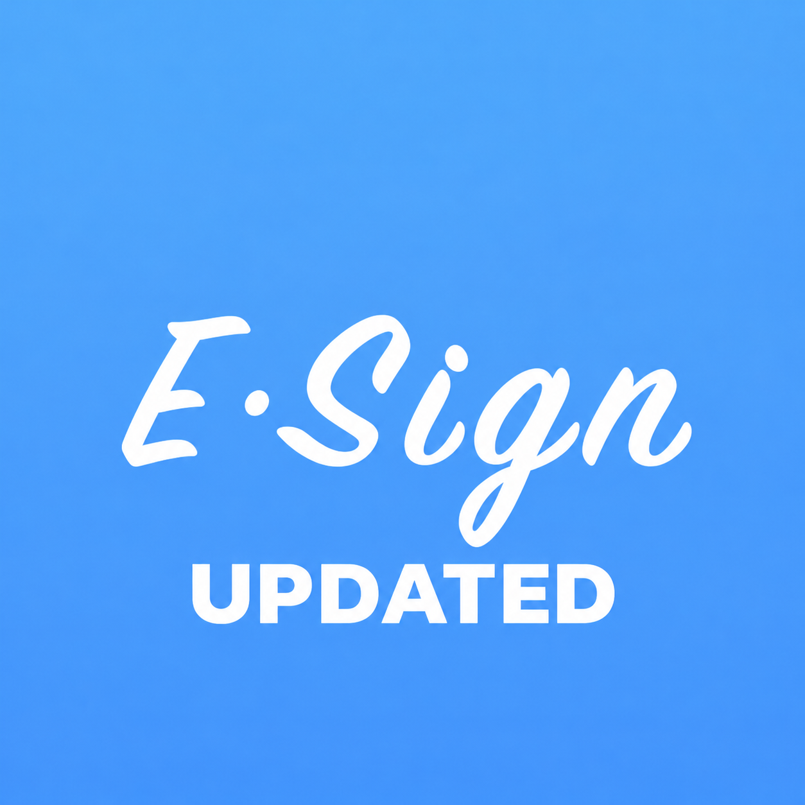
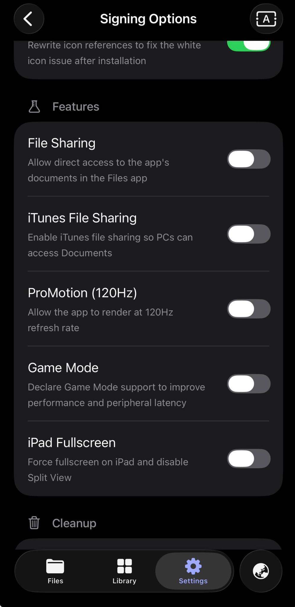
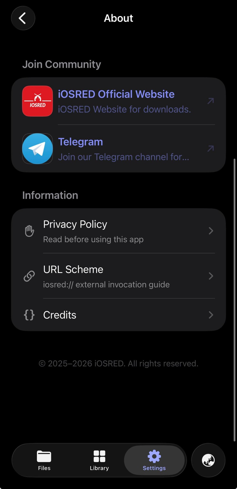

  

# ESign iOSRED — ESign IPA Signer for iPhone & iPad | 2027 Guide

**ESign iOSRED** is a customized ESign experience for signing and installing IPA apps on iPhone and iPad, managing Apple signing certificates, and restoring compatible certificates from an iOSRED account. The iOSRED team reports that this build has been tested and works on **iOS 27**. Actual installation still depends on valid signing and provisioning credentials.

**Quick links:** [ESign download and installation guide](docs/install-esign-ios.md) · [iOSRED IPA Signer](https://iosred.com/ipa-signer) · [Buy an ESign Apple Developer certificate](https://iosred.com/product/esign-certificate) · [Certificate sync guide](docs/cloud-certificate-sync.md) · [Troubleshooting / ESign not working](docs/esign-not-working.md) · [FAQ](docs/faq.md)

> **Important:** ESign iOSRED is an independently customized build and is not represented as the original EnSIgn developer's official release. The current iOSRED app is based on ESign/EnSIgn. For the original project, see [cc158999/EnSign](https://github.com/cc158999/EnSign).

## ESign iOSRED Screenshots

Real screenshots of the iOSRED-customized ESign app, showing the home-screen icon, signing options, iOSRED community links, and the certificate-management Cloud Restore menu.

| Home screen | Signing options |
|:---:|:---:|
|  |  |
| **About and community** | **Certificate Cloud Restore** |
|  |  |

The screenshots show the app interface; they do not establish signing-certificate availability or a guaranteed installation outcome.

## What is ESign iOSRED?

ESign is an on-device IPA signing and installation tool. iOSRED's build combines local signing features with iOSRED certificate-account services. You can use a compatible `.p12` certificate and `.mobileprovision` profile to sign your own IPA, or use the [iOSRED IPA Signer](https://iosred.com/ipa-signer) workflow.

### Features

- **Sign IPA files on iPhone/iPad:** use a compatible Apple signing certificate and provisioning profile, without a jailbreak.
- **Certificate management:** import supported signing credentials and manage certificates in-app.
- **iOSRED account certificate sync:** certificates uploaded through the [iOSRED IPA Signer](https://iosred.com/ipa-signer) can be associated with your account and made available through the app's Cloud Restore workflow. Sign in/use the same account and follow the restore instructions; compatibility and successful restoration depend on the certificate and account configuration.
- **Cloud Restore:** retrieve compatible certificates associated with your iOSRED account, subject to service availability.
- **IPA installation & deep links:** support for `iosred://` links, with version and file-format limitations. See [installation guide](docs/install-esign-ios.md).
- **English help and URL Scheme examples** in the customized build.

## ESign download for iOS (2026 / 2027)

**Get the latest iOSRED-supported ESign release from the official iOSRED website or this repository's Releases page once published.** Do not download re-signed IPA files from unknown mirrors.

- [iOSRED official website](https://iosred.com)
- [Releases](../../releases) (publish a signed, tested release before promoting this link)
- [Step-by-step ESign installation guide](docs/install-esign-ios.md)

**Compatibility notice:** A valid signing identity, device provisioning, iOS policy and current certificate status affect installation. No signing service can promise that a certificate will never expire or be revoked. **iOS 27 compatibility:** confirmed through iOSRED testing, according to the maintainer; device-specific results may vary.

## How to sync Apple Developer certificates with ESign iOSRED

1. Open [iosred.com/ipa-signer](https://iosred.com/ipa-signer) and sign in to your iOSRED account.
2. Upload your compatible certificate material through its secure upload workflow, following the site's instructions.
3. Use **the same iOSRED account** with ESign iOSRED's supported Cloud Restore flow to access certificates linked to the account.
4. Confirm the certificate and provisioning profile are compatible with the device and desired IPA before signing.

This sync workflow is described by iOSRED; a successful sync depends on the account, upload status and server availability. **Only upload certificates you own or are authorized to use.** `.p12` files can contain private signing keys; do not share them publicly or commit them to GitHub.

[Full certificate sync instructions](docs/cloud-certificate-sync.md)

## Need an Apple Developer certificate for ESign?

You can [view iOSRED's ESign certificate product](https://iosred.com/product/esign-certificate) or use the [iOSRED IPA Signer](https://iosred.com/ipa-signer) with eligible credentials. Pricing, provisioning, availability and support terms are shown on the purchase/service page. Purchasing a certificate is not necessary if you already have valid credentials compatible with your device and intended signing method.

## Why did ESign stop working?

If an older ESign build shows offline servers or cannot install apps, possible causes include **SSL/TLS connectivity problems, outdated configuration endpoints, incompatible API responses, or certificate issues**. iOSRED provides an updated customized build. These symptoms do not prove that every other ESign build has stopped working.

For a systematic fix, see [Why ESign isn't working: connection, certificate and install troubleshooting](docs/esign-not-working.md). iOSRED offers an updated **iOSRED-customized** ESign configuration; do not assume that all other builds are obsolete.

## Frequently asked questions

**Does ESign iOSRED require a jailbreak?** No jailbreak is required for the normal on-device signing flow, but appropriate Apple signing credentials are still required.

**Can I use my own P12?** Yes, with a matching provisioning profile and device eligibility.

**Can the iOSRED IPA Signer sync my certificate into ESign?** iOSRED's account-linked Cloud Restore workflow is intended for compatible certificates uploaded through the IPA Signer. [Read the steps](docs/cloud-certificate-sync.md).

**Is this the latest official ESign release?** It is the iOSRED-customized edition, **not** a claim of authorship or official release status from the original EnSIgn developer.

**Does it support iOS 27?** Yes. The iOSRED maintainer confirms testing on iOS 27. A valid signing certificate and device-compatible provisioning profile are still required.

[All FAQ answers](docs/faq.md)

## Support and updates

- [iOSRED](https://iosred.com) · [Telegram](https://t.me/iosred) · [Certificate product](https://iosred.com/product/esign-certificate)
- Report incorrect documentation through GitHub Issues, without uploading UDIDs, signing keys, certificate passwords or private provisioning files.

## Transparency

This repository may distribute a modified binary rather than a full source-code implementation. Do not assume the app itself is open source because the documentation is public. Licensing and redistribution rights for original components must be respected. Security-sensitive credentials are not included in this repository.

*Last documentation review: 20 November 2026. iOS 27 support is reported by the iOSRED maintainer; it is not independent Apple certification.*
