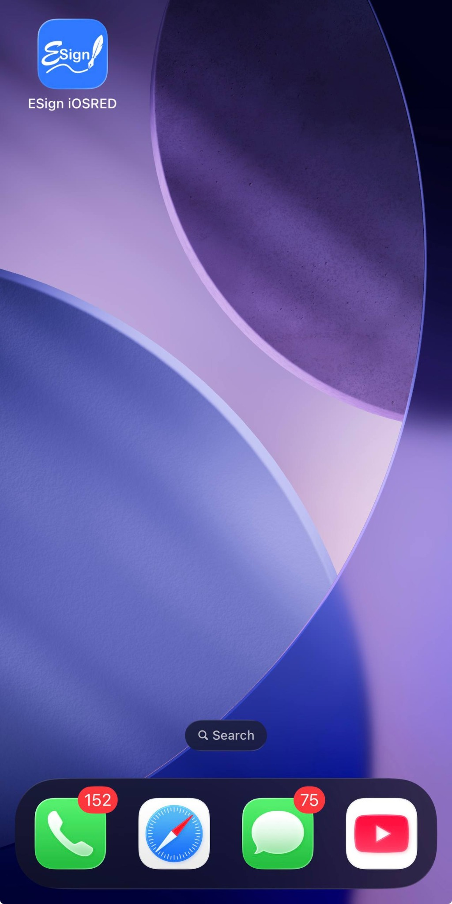
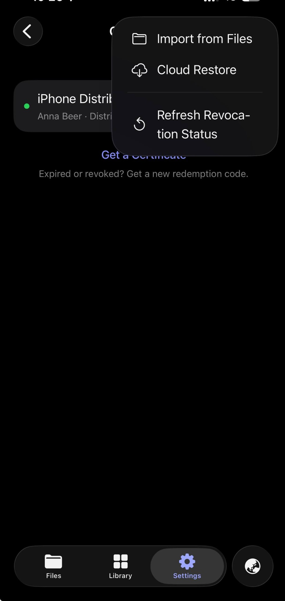

  

# ESign iOSRED — ESign IPA Signer for iPhone & iPad | 2027 Guide

**ESign iOSRED** is a customized ESign experience for signing and installing IPA apps on iPhone and iPad, managing Apple signing certificates, and restoring compatible certificates from an iOSRED account. The iOSRED team reports that this build has been tested and works on **iOS 27**. Actual installation still depends on valid signing and provisioning credentials.

**Quick links:** [ESign download and installation guide](docs/install-esign-ios.md) · [Online free IPA Signer](https://iosred.com/ipa-signer) · [Get an ESign Signing certificate](https://iosred.com/product/esign-certificate)  · [Troubleshooting / ESign not working](docs/esign-not-working.md) · [FAQ](docs/faq.md)

> **Important:** ESign 2027 is an independently customized build release. The current Esign app is based on Many Developers. For the original projects, see references

## ESign iOSRED Screenshots

Real screenshots of the iOSRED-customized ESign app, showing the home-screen icon, signing options, iOSRED links, and the certificate-management Cloud Restore menu.

| Home screen | Signing options |
|:---:|:---:|
|  |  |
| **About and community** | **Certificate Cloud Restore** |
|  |  |

The screenshots show the app interface.

## What is ESign iOSRED?

ESign is an on-device IPA signing and installation tool. iOSRED's build combines local signing features with iOSRED certificate-account services. You can use a compatible `.p12` certificate and `.mobileprovision` profile to sign your own IPA, or use the [iOSRED IPA Signer](https://iosred.com/ipa-signer) workflow. iOSRED Automatically Sync your Cerificate securly on your iOS devices, so you dont have any need to import certificate manually.

### Features

- **Sign IPA files on iPhone/iPad:** use a compatible Apple signing certificate and provisioning profile, without a jailbreak.
- **Certificate management:** import supported signing credentials and manage certificates in-app and on website
- **iOSRED account certificate sync:** certificates uploaded through the [iOSRED IPA Signer](https://iosred.com/ipa-signer) can be associated with your account and made available through the app's Cloud Restore workflow. Sign in/use the same account and follow the restore instructions; compatibility and successful restoration depend on the certificate and account configuration. Revoked Certificates are automatically deleted after some time. You also receive email when status of your certificate is changed.
- **Cloud Restore:** retrieve compatible certificates associated with your iOSRED account, syncs availability.
- **IPA installation & deep links:** support for `iosred://` links, with version and file-format limitations. See [installation guide](docs/install-esign-ios.md).
- **English help and URL Scheme examples** in the customized build.

## ESign download for iOS (2026 / 2027)

**Get the latest iOSRED-supported ESign release from the official iOSRED website or this repository's Releases page .** Do not download re-signed IPA files from unknown mirrors.

- [iOSRED official website](https://iosred.com)
- [Releases](../../releases)
- [Step-by-step ESign installation guide](docs/install-esign-ios.md)

**Compatibility notice:** A valid signing identity, device provisioning, and current certificate status affect installation. No signing service can promise that a certificate will never expire or be revoked. **iOS 27 compatibility:** confirmed through testing.

## How to sync Apple Developer certificates with ESign iOSRED

1. Open [iosred.com/ipa-signer](https://iosred.com/ipa-signer) and sign in to your iOSRED account.
2. Upload your compatible certificate .p12 and provision profile and Password through secure upload workflow, following the site's instructions.
3. Sign the ipa using your certificate at  free ipa signer [iosred.com/ipa-signer](https://iosred.com/ipa-signer). uploading the certificate supportes Cloud Restore flow to sync certificates directly to Esign App.

## Need an Apple Developer certificate for ESign?

You can [view iOSRED's ESign certificate product](https://iosred.com/product/esign-certificate) and use the [iOSRED IPA Signer](https://iosred.com/ipa-signer). Pricing, provisioning, availability and support terms are shown on the purchase/service page. Purchasing a certificate is not necessary if you already have valid credentials compatible with your device.

## Why did OLD ESign stop working?

If an older ESign build stucks  or cannot install apps, the causes were **SSL/TLS connectivity problems, outdated configuration endpoints, incompatible API responses**. iOSRED provides an updated customized build. 

## Frequently asked questions

**Does ESign iOSRED require a jailbreak?** No jailbreak is required for the normal on-device signing flow, but appropriate Apple signing credentials are still required.

**Can I use my own P12?** Yes, with a matching provisioning profile and device eligibility.

**Can the iOSRED IPA Signer sync my certificate into ESign?** iOSRED's account-linked Cloud Restore service is free for all and certificates are uploaded through the IPA Signer. [Read the steps](docs/cloud-certificate-sync.md).

**Is this the latest official ESign release?**  Yes it is latest by Us.

**Does it support iOS 27?** Yes. it works on iOS 27. A valid signing certificate and device-compatible provisioning profile are still required.

[All FAQ answers](docs/faq.md)

## Support and updates

- [iOSRED](https://iosred.com) · [Telegram](https://t.me/iosred) · [Certificate product](https://iosred.com/product/esign-certificate)
- Report incorrect documentation through GitHub Issues, without uploading UDIDs, signing keys, certificate passwords or private provisioning files.

## Transparency

This repository may distribute a modified binary rather than a full source-code implementation. Do not assume the app itself is open source because the documentation is public. Licensing and redistribution rights for original components must be respected. Security-sensitive credentials are not included in this repository.

*Last documentation review: 20 November 2026.*
